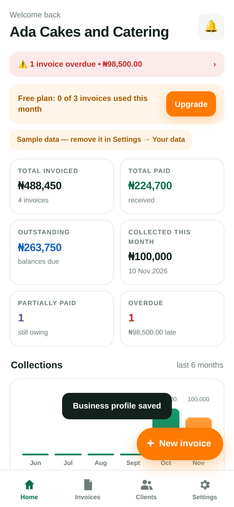
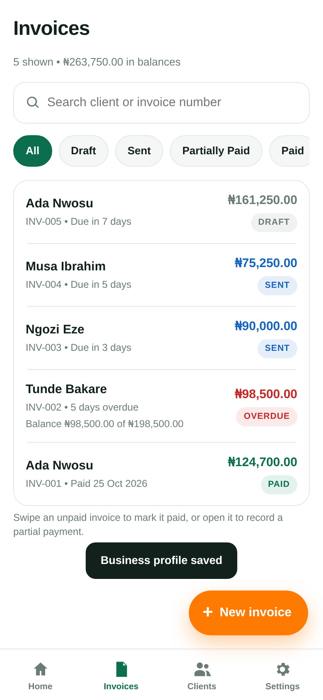
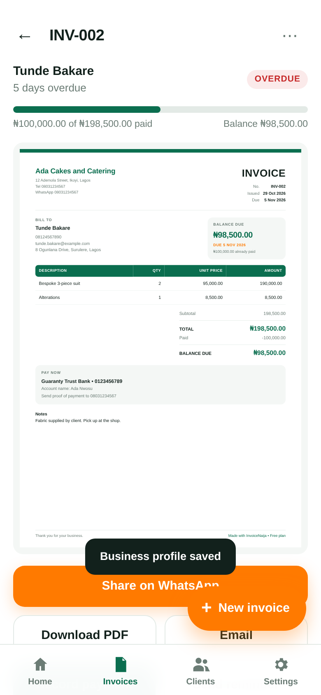
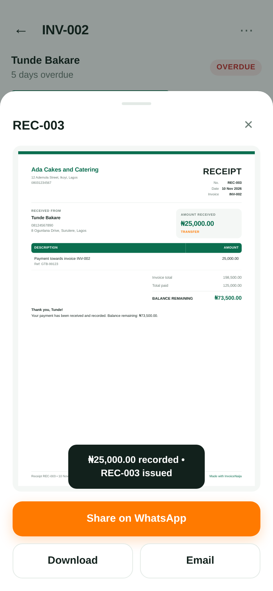
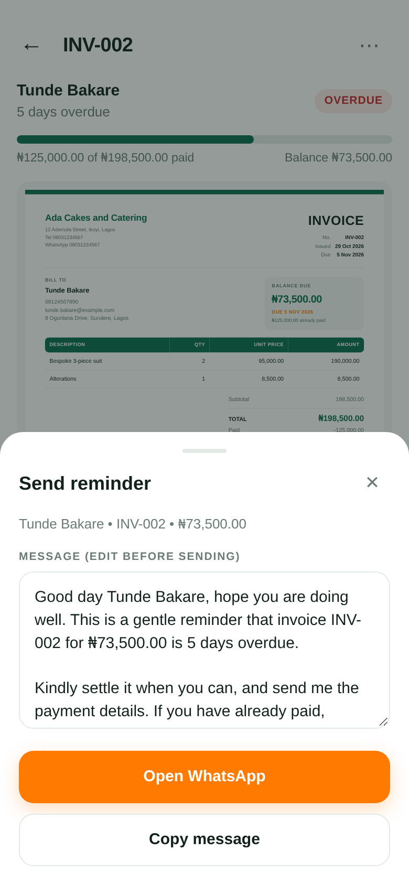
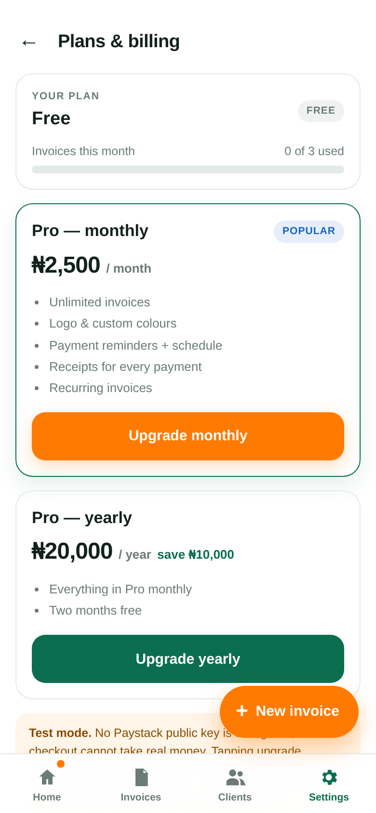
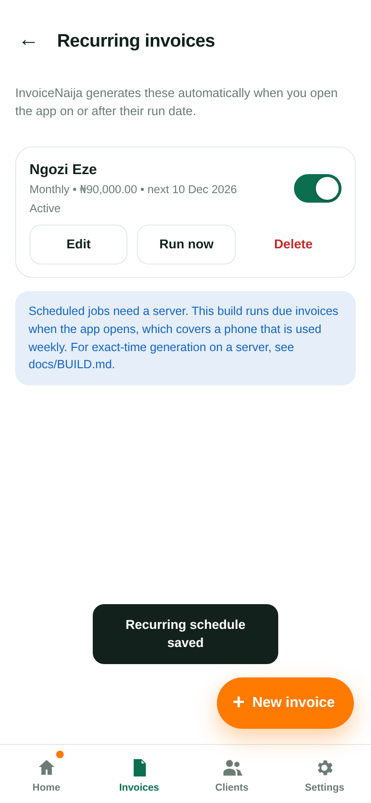
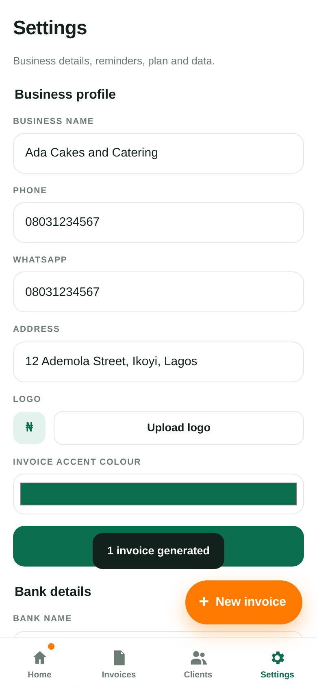
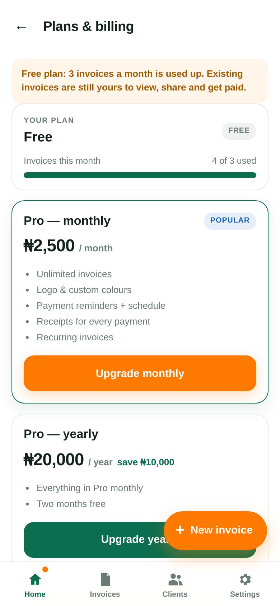

# InvoiceNaija

**Create, send and track professional invoices in 30 seconds. Built for Nigerian freelancers and artisans — tailors, plumbers, electricians, photographers, POS vendors and small shops in Abuja and Lagos.**

Naira only, offline-first, installable as an app on Android (Capacitor) or in the browser (PWA).

Current release: **0.2.0-beta**



## What it does

**Invoices**
- Business profile, logo, bank details, `INV-001` numbering per business, VAT 7.5% charged after discount, discounts, notes, due dates
- Printable A4 PDF and a prefilled WhatsApp message, per invoice
- Statuses: Draft, Sent, Partially Paid, Paid, Overdue (Overdue is derived from the due date, never typed in)

**V2 additions**
- **Partial payments** — record amount, date, method (Cash/Transfer/POS/Other), reference and note. The amount can never exceed the balance. A balance-due bar and full payment history sit on the invoice.
- **Receipts** — every payment issues a branded PDF receipt (`REC-001`, per business) with the invoice reference, amount paid, balance remaining and a thank-you line. Download, share on WhatsApp or email it, and see receipts per invoice and per client.
- **Payment reminders** — editable template with `{client_name} {invoice_number} {amount_due} {due_date} {business_name} {pay_link}`, a schedule of 3 days before / on the due date / 3, 7 and 14 days after, a one-tap WhatsApp send, a log of every reminder, and in-app + system notifications when invoices need follow-up.
- **Recurring invoices** — weekly, monthly, quarterly or yearly, optional end date, pause/resume, "run now", edit and delete. A due schedule generates the next numbered invoice automatically.
- **Plans and limits** — Free (3 invoices a month, basic template), Pro ₦2,500/month or ₦20,000/year, pay-per-invoice ₦200 for a branded PDF. Paystack checkout, a usage counter and a paywall that never blocks viewing, sharing or getting paid on existing invoices.
- **Dashboard v2** — total invoiced, paid, outstanding, collected this month, partially paid count, overdue count, a six-month collections chart and a needs-follow-up list, all driven by balances rather than invoice totals.

## Screens

| Invoices | Part-paid invoice | Receipt | Reminder |
| --- | --- | --- | --- |
|  |  |  |  |

| Plan screen | Recurring | Settings | Paywall |
| --- | --- | --- | --- |
|  |  |  |  |

Screenshots are produced by the smoke test (`npm run test:smoke`), so they always match the shipped code.

## Run it

```bash
npm ci                 # dependencies (Vite-free: plain ES modules)
npm test               # 22 unit tests for money, VAT, partial payments, reminders, plans
npm run serve          # http://localhost:8080
npm run test:smoke     # drives the real app in Chromium and saves ./screenshots
```

Requires Node 20+ and, for the Android build, JDK 17 + Android SDK 34.

## Build the Android app

```bash
npx cap sync android       # copies www/ into the Android project
cd android && ./gradlew assembleDebug
# app/build/outputs/apk/debug/app-debug.apk
```

Full details, including signing, GitHub Actions and Store steps, are in [docs/BUILD.md](docs/BUILD.md).

## How the money works

Every amount is an integer number of kobo. `7.5%` VAT is basis points (750), charged on the subtotal **after** discount and rounded half-up to the kobo: 7.5% of ₦1.00 is 8 kobo, never 7.4. Balances are `total - payments`, floored at zero, so an overpayment never shows as a credit. `npm test` covers each of these cases.

## Data and privacy

Everything is stored on the device (`localStorage`), one bucket per account. The PIN is salted and SHA-256 hashed; there is no server, so the PIN protects the app on the device. Nothing is uploaded unless you tap share.

## Known limitations (honest list)

1. **Paystack is configured but not live in this build.** No public key ships in the repo, so the Upgrade screen runs in clearly-labelled test mode and activates Pro locally. Real checkout needs `paystackPublicKey` plus a server that verifies the reference with the secret key — the exact steps and a ready-to-deploy function are in [docs/BUILD.md](docs/BUILD.md#paystack).
2. **Google sign-in is wired but unconfigured.** Add `googleClientId` to `www/config.js`; without it the button explains the missing step instead of pretending.
3. **Recurring runs on app open, not on a server cron.** This is a static PWA with no backend, so due schedules are generated when the app is next opened (including several missed runs). Exact-time generation needs the cron job described in BUILD.md.
4. **Push notifications while the app is closed need a server.** In-app alerts work; system notifications appear while the app is open.
5. **WhatsApp cannot take a file from a link on the web.** In the browser the PDF downloads and the chat opens with the message so you attach it; on Android the share sheet hands over the actual file.
6. **Email attachments:** the mail client opens with the body prefilled; attach the downloaded PDF.
7. **The APK is debug-signed** for assessment. A Play Store build needs the signing steps in BUILD.md.
8. **No Android emulator was available here.** The APK is verified by a clean build, manifest/dex inspection and signature check, and the identical web bundle is verified by the Chromium smoke test.

## GitHub Actions (one manual step)

The workflow that builds this APK lives in [`ci/android-workflow.yml`](ci/android-workflow.yml). It could not be
pushed to `.github/workflows/android.yml` from here because the publishing token does not carry the `workflow`
scope, so GitHub refuses to create workflow files with it. Two one-minute ways to switch it on:

1. On GitHub: **Add file → Create new file**, name it `.github/workflows/android.yml`, paste the contents of
   `ci/android-workflow.yml`, commit. It then runs on every push to `main` and on `v*` tags, runs `npm test`,
   builds the APK and attaches it to the `v0.2.0-beta` release.
2. Or re-run `git push` with a token that has the `workflow` scope after moving the file back.

The APK attached to the release was built locally with exactly the commands the workflow runs.

## Licence

MIT. See [LICENSE](LICENSE).
